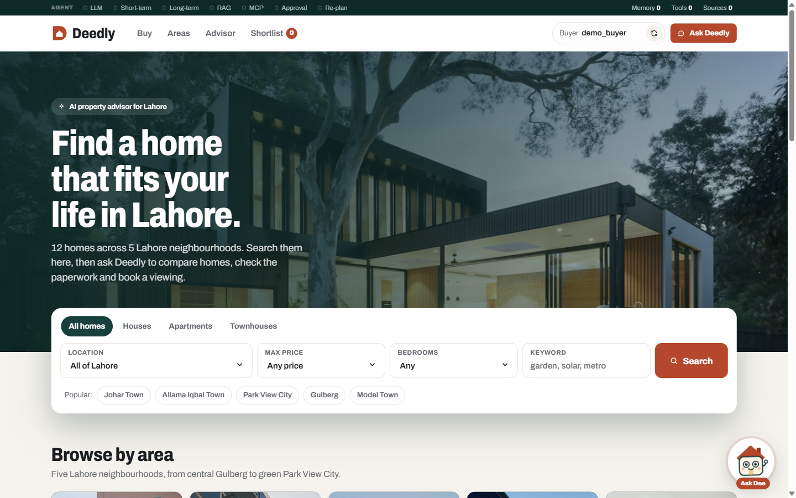
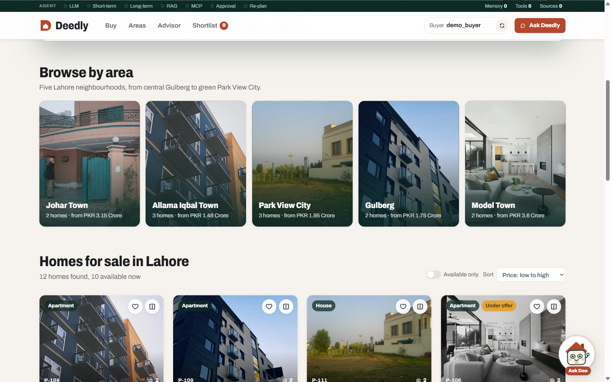
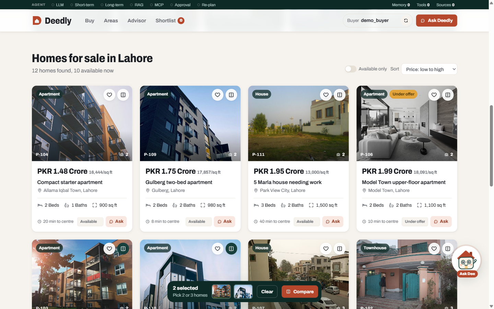
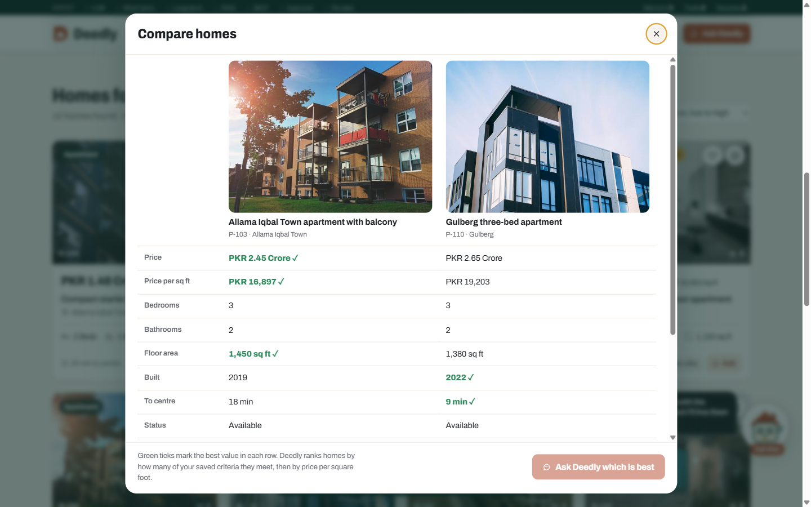
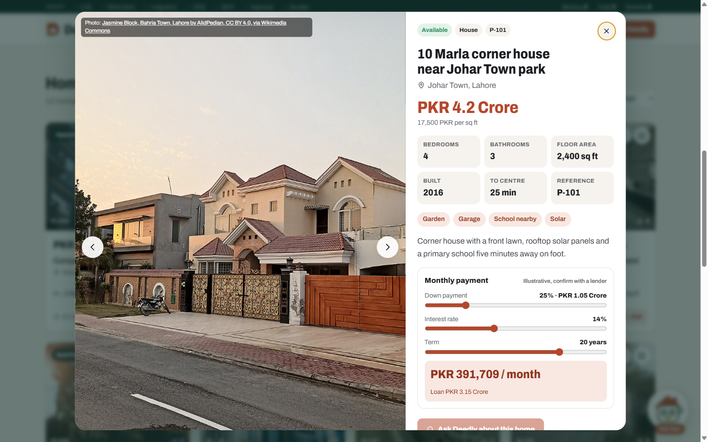
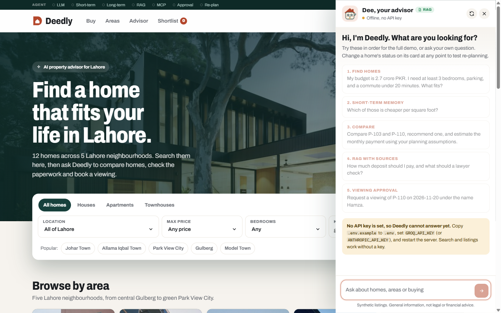
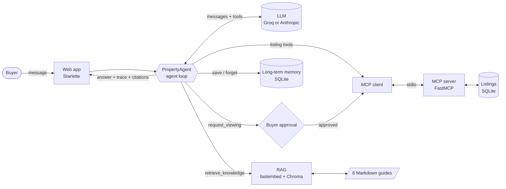
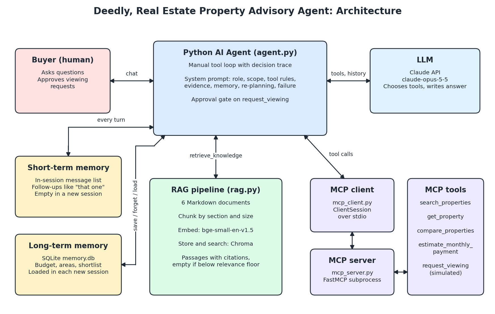

<div align="center">


# Deedly

**An AI property advisor for Lahore that searches homes, remembers buyers, compares options and cites its sources.**


Assignment 2, Agent Based Modeling (AIDE3313), scenario 38: *retrieve property details, remember buyer preferences and compare options.*

</div>

> All listings, prices and documents are synthetic. The areas are real parts of Lahore, but no home here is for sale. Viewing requests are simulated. Deedly gives general information, not legal or financial advice.

---

## Contents

- [Overview](#overview)
- [Screenshots](#screenshots)
- [Features](#features)
- [How it works](#how-it-works)
- [Assignment requirements](#assignment-requirements)
- [Tech stack](#tech-stack)
- [Project structure](#project-structure)
- [Getting started](#getting-started)
- [Usage](#usage)
- [Configuration](#configuration)
- [HTTP API](#http-api)
- [MCP tools](#mcp-tools)
- [Testing](#testing)
- [Deployment](#deployment)
- [Data and credits](#data-and-credits)
- [Limitations and roadmap](#limitations-and-roadmap)
- [Author](#author)

---

## Overview

Deedly is a property portal with an AI agent built in. A buyer can search and filter 180 homes across 14 Lahore areas (Johar Town, Allama Iqbal Town, Model Town, Park View City, Gulberg, DHA Phase 5, DHA Phase 6, Lahore Cantt, Bahria Town, Lake City and Wapda Town, plus the farmhouse belts on Bedian, Barki and Raiwind Road), from 3 marla houses to 4 kanal bungalows and 10 kanal farmhouses, filtered by plot size, like on any listings site, on a grid or a map, then open the advisor, **Dee**, and ask in plain language:

> *"My budget is 2.7 crore. I need at least 3 bedrooms, parking and a commute under 20 minutes. What fits?"*

Behind that answer the agent:

1. saves the budget to **long-term memory** (SQLite locally, Postgres when hosted),
2. searches live listings through a real **MCP server**,
3. reads the buying guides through **hybrid RAG** and cites them, with every citation checked against what was actually retrieved,
4. keeps the conversation as **short-term memory** for follow-ups like *"which of those is cheaper per square foot?"*,
5. **re-plans** if a home is sold mid-conversation,
6. and stops for **human approval** before sending any viewing request.

Every one of those steps is shown on screen as it happens, so the agent's work can be checked rather than taken on trust.

---

## Screenshots

| Home and search | Browse by area |
|---|---|
|  |  |

| Listings with shortlist and compare | Side-by-side comparison |
|---|---|
|  |  |

| Home sheet with mortgage calculator | Advisor with Dee |
|---|---|
|  |  |

---

## Features

### For the buyer

- **Portal-style search.** Type tabs (houses, apartments, townhouses), location, max price, bedrooms and keyword, plus quick area chips.
- **Browse by area.** Eight Lahore neighbourhoods with home counts and starting prices.
- **Map view.** Switch the listings between a grid and an OpenStreetMap map (Leaflet). Pins follow the active filters and are coloured by status.
- **Listing grid.** Sort by price, value per square foot, newest or shortest commute. Filter to available homes only. Every active filter shows as a removable chip.
- **Shortlist.** A heart on every home. The shortlist is stored in the buyer's long-term memory, so the agent knows about it in later sessions.
- **Compare.** Pick two or three homes for a side-by-side table that ticks the best price, value, size, commute and estimated monthly payment, then ask Dee to recommend one.
- **Home sheet.** Photo gallery (arrow keys work), facts, features and a **mortgage calculator** with deposit, rate and term sliders. It uses the same formula as the agent's payment tool, so the numbers always agree.
- **Advisor drawer.** Chat with Dee. Answers stream in word by word. Homes named in an answer appear as cards and are highlighted in the grid as *Advisor picks*.
- **Checkable sources.** Every citation in an answer is a button that opens the exact passage Dee retrieved.
- **Chat and grid in sync.** When Dee searches listings, the grid switches to the same filters. *Ask about these* sends the current filters or shortlist to Dee.
- **Urdu.** A language switch makes Dee reply in Urdu script, keeping listing ids, amounts and citations unchanged.
- **Save as PDF.** Export the current results, the shortlist or a comparison as a printable report.

### For the marker

- **Agent bar.** One thin line across the top: LLM, short-term memory, long-term memory, RAG, MCP, approval and re-planning. A dot turns green only when that component really runs. Hovering explains what happened.
- **Live tool steps.** While Dee works, each step appears in the chat, tagged `MCP`, `RAG` or `MEM`.
- **Record dropdown.** Saved memory, raw tool input and output, and retrieved sources with similarity scores.
- **Re-planning control.** Each card has a status control. Mark a home sold and ask about it to watch the agent re-check.
- **Approval gate.** Viewing requests show exactly what will be sent and wait for Approve or Decline. Declining means the MCP server is never called.
- **Grounding check.** A sentence that cites a passage the agent never retrieved is removed before the buyer sees it, and a notice says so.
- **Evaluation report.** `python -m evals.run_evals` scores retrieval (hit@k, MRR, off-topic rejection) and 22 scripted agent scenarios, and writes `evidence/eval_report.md`.

### Dee, the live mascot

An original animated house character drawn in SVG. Dee's eyes follow the pointer, blink and bob. Dee waves on hover, thinks while a message is sent, puffs chimney smoke while tools run, puts on reading glasses while searching the guides, cheers when an answer lands and floats a heart when a home is shortlisted. Dee also gives short tips in a speech bubble. All motion stops under *reduce motion*.

---

## How it works

### Agent workflow



### One turn, step by step

1. The buyer's message is added to the session's message list (short-term memory).
2. The agent sends the system prompt, the saved buyer profile, the tool list and the conversation to the LLM.
3. The LLM either answers or asks for tools.
4. The agent runs each tool. Listing tools go through the **MCP client** to the server subprocess. Knowledge and memory tools run locally. Every call is recorded in a trace and streamed to the browser.
5. Results go back to the LLM. Steps 3 to 5 repeat until a final answer, up to 10 steps.
6. `request_viewing` is intercepted by an approval check **in code**, not only in the prompt, and waits for the buyer's click.

The server streams events to the browser as NDJSON (`tool`, `approval`, `done`), which is what drives the agent bar, the live steps and Dee's reactions.



More detail, including the system prompt justification, is in [docs/ARCHITECTURE.md](docs/ARCHITECTURE.md).

---

## Assignment requirements

| Requirement | Where | How to see it |
|---|---|---|
| Python agent + LLM | `realestate_agent/agent.py`, `llm.py` | Agent bar *LLM* dot, any answer |
| Short-term memory | `PropertyAgent.messages` | Ask a follow-up: *"which is cheaper per sq ft?"* |
| Long-term memory | `realestate_agent/memory.py` (SQLite, or Postgres via `DATABASE_URL`) | State a budget or heart a home, start a new session, ask again |
| RAG with citations, 10 documents | `knowledge/`, `realestate_agent/rag.py` | Ask about deposits or title checks, see green citations and `RAG` steps, click one to read the passage |
| Grounded answers | `PropertyAgent._check_grounding` in `agent.py` | Citations to unretrieved passages are removed with their sentence |
| MCP client and server | `mcp_client.py`, `mcp_server.py` | `MCP` steps in chat, `tests/test_mcp.py` |
| Prompt engineering | `realestate_agent/prompts.py` | Justified in `docs/ARCHITECTURE.md` |
| Tests and error handling | `tests/` | `python -m pytest tests -v` |
| Evaluation | `evals/` | `python -m evals.run_evals`, report in `evidence/eval_report.md` |
| Human oversight | Approval gate in `agent.py` and `web.py` | Ask for a viewing |
| Re-planning | Prompt rules + live status via MCP | Demo step 5 marks P-103 sold and asks about it, or use `/sold P-103` in the terminal chat |

---

## Tech stack

| Layer | Technology |
|---|---|
| Language | Python 3.11+ (developed on 3.14) |
| Web server | Starlette (ASGI) on Uvicorn, NDJSON streaming |
| Frontend | One HTML page, vanilla JavaScript and CSS, no build step, inline SVG icons and mascot |
| LLM | Groq (best available tool-capable model, picked automatically, OpenAI-compatible API through the `openai` SDK) or Anthropic (`claude-opus-5-5` through the `anthropic` SDK) |
| Agent loop | Hand-written tool-use loop with tracing and an approval gate |
| Tools protocol | Model Context Protocol: `FastMCP` server over stdio, official `ClientSession` client |
| RAG | `fastembed` (`BAAI/bge-small-en-v1.5`, runs locally) + `chromadb` (cosine), section-aware chunking. Hosted builds use a pure-Python BM25 retriever over the same chunks and citations |
| Storage | SQLite for listings, viewing requests and buyer memory |
| Config | `python-dotenv` |
| Testing | `pytest`, Starlette `TestClient`, a scripted LLM for deterministic agent tests |
| Fonts and images | Self-hosted Archivo variable font, local photos from Unsplash and Wikimedia Commons |

---

## Project structure

```
real-estate-agent/
├── realestate_agent/            # The application package
│   ├── agent.py                 # Agent loop: LLM ↔ tools, trace, approval gate, error handling
│   ├── llm.py                   # Provider choice + Groq adapter (OpenAI format ↔ agent format)
│   ├── prompts.py               # System prompt and saved-profile block
│   ├── mcp_server.py            # FastMCP server exposing the listing tools
│   ├── mcp_client.py            # MCP stdio client: list_tools / call_tool
│   ├── properties.py            # Listing store, comparison and payment logic (SQLite)
│   ├── rag.py                   # Chunking, hybrid retrieval (embeddings + BM25), citations
│   ├── memory.py                # Long-term buyer memory (SQLite or Postgres)
│   ├── web.py                   # Starlette app: pages, chat stream, approval, shortlist, status
│   ├── cli.py                   # Terminal chat
│   ├── config.py                # Paths and settings
│   ├── ingest.py                # Rebuild the RAG index
│   └── static/
│       ├── index.html           # The whole frontend: portal, advisor drawer, Dee the mascot
│       ├── tokens.css           # Colour, type and spacing tokens
│       ├── fonts/               # Archivo variable font
│       ├── brand/               # Logo, favicon, brand board
│       └── homes/               # Listing photos, photos.json, CREDITS.md
├── data/properties.json         # 180 synthetic listings (seed data)
├── data/pk_photos.json          # Pakistani house photos used by generated listings (with licences)
├── knowledge/                   # 10 Markdown guides used by RAG
├── evals/                       # Retrieval and agent-behaviour evaluation harness
├── scripts/                     # Listing generator, UI smoke server (no API key needed)
├── .github/workflows/tests.yml  # CI: pytest with Postgres, retrieval evaluation
├── tests/                       # 92 tests: agent, grounding, MCP, RAG, memory, properties, web, Groq adapter
├── docs/
│   ├── ARCHITECTURE.md          # Design, components, prompt justification, limitations
│   ├── architecture.png         # Architecture diagram
│   ├── make_diagram.py          # Script that draws the diagram
│   └── screenshots/             # Images used in this README
├── evidence/                    # Test results and the evaluation report
├── app.py                       # Hosted entrypoint (top-level ASGI app)
├── pyproject.toml               # Hosted dependency set and Vercel entrypoint
├── vercel.json                  # Function duration and bundle excludes
├── demo.py                      # Scripted end-to-end demo with the real LLM
├── DESIGN.md                    # Design system: colours, components, mascot states
├── PRODUCT.md                   # Product brief
├── requirements.txt             # Full local install, including embeddings and Chroma
└── .env.example                 # Copy to .env and add one API key
```

Runtime data (`runtime/`: SQLite databases and the Chroma index) is created on first run and is not committed.

---

## Getting started

### Prerequisites

- Python 3.11 or newer
- An API key from **Groq** ([console.groq.com/keys](https://console.groq.com/keys), free tier available) **or** **Anthropic** ([console.anthropic.com](https://console.anthropic.com))
- About 100 MB of disk for the embedding model, downloaded on first run

### Install

```bash
git clone https://github.com/Hamzaviour/Deedly-Real-Estate-AI-Agent.git
cd Deedly-Real-Estate-AI-Agent
python -m venv .venv
# Windows
.venv\Scripts\activate
# macOS / Linux
source .venv/bin/activate

pip install -r requirements.txt
```

### Configure

```bash
# Windows
copy .env.example .env
# macOS / Linux
cp .env.example .env
```

Open `.env` and set **one** key:

```ini
GROQ_API_KEY=gsk_...
# or
ANTHROPIC_API_KEY=sk-ant-...
```

Search, listings, shortlist, compare and the calculator all work without a key. Only the advisor needs one.

---

## Usage

### Web app

```bash
python -m realestate_agent.web
```

Open **http://127.0.0.1:8011**. The server binds to localhost only and has no login, so keep it on your own machine. Set `RE_AGENT_PORT` to use another port.

### Demo script for a live presentation

Open the advisor and run the six prompts in order. They are also listed in the drawer:

| # | Shows | Prompt |
|---|---|---|
| 1 | Search, MCP, long-term memory | *My budget is 2.7 crore PKR. I need at least 3 bedrooms, parking, and a commute under 20 minutes. What fits?* |
| 2 | Short-term memory | *Which of those is cheaper per square foot?* |
| 3 | Compare + payment tool | *Compare P-103 and P-110, recommend one, and estimate the monthly payment using your planning assumptions.* |
| 4 | RAG with citations | *How much deposit should I pay, and what should a lawyer check?* |
| 5 | Re-planning | Marks P-103 sold, then: *I've decided on P-103. Please re-check it and tell me what to do next.* |
| 6 | Human approval | *Request a viewing of P-110 on 2026-11-20 under the name Hamza.* |

Then:

- **Re-planning by hand:** set any home to *Sold* on its card and ask about it.
- **Long-term memory across sessions:** click the refresh icon next to the buyer name (new session) and ask *"What's my budget?"*

### How to see each agent feature

The proof bar at the top of the page (LLM, Short-term, Long-term, RAG, MCP, Approval, Re-plan) lights up each time the agent uses that capability. Hover a dot to see what triggered it.

| Feature | What to do | What you should see |
|---|---|---|
| **RAG** | Ask a procedure or area question: *"What should a lawyer check before I pay a deposit?"*, *"Is Lake City good for families?"*, *"How many square feet is a 5 kanal farmhouse?"* | Answer with citation chips such as `title verification`. Click a chip to open the exact source passage. The RAG dot turns on. |
| **MCP tools** | Ask for listings: *"Show 1 kanal houses in DHA Phase 5 under 12 crore"* or *"Any farmhouses on Bedian Road?"* | The agent calls `search_properties` (with `min_marla`/`max_marla` for plot size) through the MCP server. The grid syncs to the same filters. |
| **Short-term memory** | After a search, ask *"Which of those is cheapest per square foot?"* | The agent resolves "those" from this conversation without searching again. |
| **Long-term memory** | Say *"My budget is 3 crore and I want a garden."* Then click the refresh icon next to the buyer name and ask *"What do you know about me?"* | The budget and garden preference come back in the new session. Memory count goes up in the top bar. |
| **Re-planning** | Ask the agent to compare two homes (e.g. *"Compare P-103 and P-110"*). Then change P-103's status to **Sold** with the small status menu on its card and ask *"I'll go with P-103, what next?"* | The agent re-checks P-103, says it is sold, drops it and re-ranks the rest against the same criteria. The Re-plan dot turns on. In the terminal, use `/sold P-103`. |
| **Human approval** | Ask *"Request a viewing of P-110 on 2026-11-20 under the name Hamza."* | An approval card appears with the home, date and name. Nothing is sent until you click **Approve request**. **Decline** cancels it. In the terminal you get `Approve ...? [y/N]`. |

The advisor needs `GROQ_API_KEY` or `ANTHROPIC_API_KEY` in `.env`. Search, filters (type, area, price, bedrooms, plot size), map, shortlist, compare and the mortgage calculator work without one.

### Terminal chat

```bash
python -m realestate_agent.cli --user hamza
```

Viewing requests ask `Approve ...? [y/N]` in the terminal. Type `/sold P-103` to mark a home sold mid-conversation and watch the agent re-plan, or `/quit` to leave. Start again with the same `--user` to see long-term memory.

### Scripted end-to-end demo

```bash
python demo.py
```

This runs a full scripted session against the real LLM in isolated storage and writes a transcript to `evidence/demo_transcript.md`.

### Rebuild the RAG index

After editing anything in `knowledge/`:

```bash
python -m realestate_agent.ingest
```

---

## Configuration

| Variable | Default | Purpose |
|---|---|---|
| `GROQ_API_KEY` | | Use Groq as the LLM provider |
| `GROQ_MODEL` | auto | Groq model. Unset, Deedly asks Groq which models your key can use and picks the best tool-capable one, so retired models never break it |
| `ANTHROPIC_API_KEY` | | Use Anthropic as the LLM provider |
| `RE_AGENT_MODEL` | `claude-opus-5-5` | Anthropic model |
| `RE_AGENT_PROVIDER` | auto | `groq` or `anthropic`. Auto picks Anthropic if its key is set, otherwise Groq |
| `RE_AGENT_PORT` | `8011` | Web server port |
| `RE_AGENT_RUNTIME` | `./runtime` (`/tmp/deedly` on Vercel) | Where SQLite databases and the Chroma index are stored |
| `RE_AGENT_RAG` | auto | `hybrid`, `embeddings` or `lexical` (BM25). Auto uses hybrid when embeddings are installed, BM25 on Vercel |
| `DATABASE_URL` | | Postgres URL (for example Neon). When set, long-term memory is stored there instead of SQLite, so it survives serverless cold starts |
| `RE_AGENT_SECRET` | random per process | Signs the browser cookie that scopes buyer names on a public deployment. Set it on Vercel so cookies work across instances |
| `RE_AGENT_SCOPE_USERS` | off locally, on when hosted | `1` scopes each typed buyer name to the browser's signed cookie |
| `RE_AGENT_CHAT_LIMIT` | `25` | Hosted only: chat messages per visitor per hour, to protect the API key |

---

## HTTP API

All `POST` endpoints require `Content-Type: application/json`. Requests addressed to any host other than localhost are rejected.

| Method | Path | Body | Returns |
|---|---|---|---|
| `GET` | `/` | | The web app |
| `GET` | `/api/state?user=` | | Listings, saved memory, shortlist, model name, MCP tools, whether the LLM is ready |
| `GET` | `/api/passage?id=` | | The full text behind a citation such as `03_financing_affordability.md#1` |
| `POST` | `/api/chat` | `{user, message, lang}` | NDJSON stream of `text`, `tool`, `approval` and `done` events. `lang` is `en` or `ur` |
| `POST` | `/api/approve` | `{user, id, approved}` | Resolves a pending viewing request |
| `POST` | `/api/reset` | `{user}` | Starts a new session. Long-term memory is kept |
| `POST` | `/api/shortlist` | `{user, id, on}` | Adds or removes a home in the buyer's shortlist memory |
| `POST` | `/api/status` | `{id, status}` | Demo control: `available`, `under_offer` or `sold` |

---

## MCP tools

Served by `realestate_agent/mcp_server.py` and discovered by the client at startup.

| Tool | Purpose |
|---|---|
| `search_properties` | Filter listings by price, bedrooms, area and type |
| `get_property` | Live details and status of one home |
| `compare_properties` | Check homes against the buyer's criteria and rank them |
| `estimate_monthly_payment` | Amortised loan payment |
| `affordability_check` | Highest price a buyer can plan for, using the financing guide's 35 percent rule |
| `area_price_stats` | Median price, price per square foot and per marla by area |
| `request_viewing` | Simulated viewing request. Gated by buyer approval |

Local tools: `retrieve_knowledge` and `area_guide` (RAG), `save_preference` and `forget_preference` (long-term memory).

Comparison and payment maths are deterministic Python, so the model never does arithmetic or ranking from memory.

---

## Testing

```bash
python -m pytest tests -v
```

No API key is needed. The tests use the real MCP server, real SQLite, real embeddings and real Chroma. The LLM is scripted, so they check the agent's plumbing (tool routing, approval, memory, error recovery, streaming), not the model's judgement. `demo.py` exercises the real model.

| File | Covers |
|---|---|
| `test_agent.py` | Tool loop, tracing, approval gate, error and refusal handling, history repair |
| `test_mcp.py` | MCP discovery and calls over stdio |
| `test_rag.py` | Chunking, retrieval quality and relevance floor for both embeddings and BM25 |
| `test_memory.py` | Save, replace, forget, isolation between buyers |
| `test_properties.py` | Search, compare ranking, payment maths, status changes |
| `test_web.py` | Pages, streaming chat, approval, sessions, shortlist, security checks |
| `test_llm.py` | Groq adapter translation, streaming and provider selection |

### Evaluation

```bash
python -m evals.run_evals --retrieval-only --compare-retrievers   # no API key needed
python -m evals.run_evals                                        # adds the 22 agent scenarios
```

The retrieval part asks 36 questions (30 the documents cover, 6 they do not) and reports hit@1, hit@4, mean reciprocal rank and off-topic rejection, for each retriever on its own and for the hybrid. The agent part runs 22 scenarios against the real model, MCP server and retriever, each in fresh storage, and checks tool choice, verified citations, answer text, approvals and saved memory. Scenarios cover tool selection, short-term and long-term memory, RAG grounding, uncertainty, scope, policy, privacy, re-planning and human oversight. Results go to `evidence/eval_report.md` and `evidence/eval_results.json`.

---

## Deployment

### Vercel

The repository deploys to Vercel as a Python (ASGI) function with no extra setup:

- `app.py` exposes the Starlette `app`, and `pyproject.toml` names it as the entrypoint.
- `pyproject.toml` holds a **light dependency set**. RAG switches to the built-in **BM25** retriever, so no embedding model download or Chroma is needed. Citations and the relevance floor work the same way.
- Runtime data goes to `/tmp/deedly`. Listings are re-seeded from `data/properties.json` on each cold start.
- The MCP server still runs as a real stdio subprocess inside the function.
- Each visitor gets a small hourly chat budget (`RE_AGENT_CHAT_LIMIT`), because a public deployment spends the owner's API key.

Steps:

1. Import the GitHub repository in Vercel, or run `vercel deploy --prod` from a clean clone.
2. In **Project → Settings → Environment Variables**, add `GROQ_API_KEY` (or `ANTHROPIC_API_KEY`) and `RE_AGENT_SECRET` (any long random string). Add `DATABASE_URL` for a Postgres database, such as Neon, to keep long-term memory across cold starts. Then redeploy.

**Known trade-offs on serverless:** conversations and status changes live in instance memory and `/tmp`, so a cold start resets them (long-term memory and shortlists persist when `DATABASE_URL` is set), and a viewing approval can expire if the platform moves the request to a different instance. For a demo that must behave exactly like local, run it locally or on a host with a long-running process and a persistent disk.

### Local or a long-running host

```bash
pip install -r requirements.txt
python -m realestate_agent.web
```

---

## Data and credits

- **Listings and documents** are synthetic, written for this coursework. Area names are real parts of Lahore.
- **Photos** are illustrative, not the listed homes:
  - Real photos of Pakistani houses (Lahore, Islamabad, Rawalpindi, Faisalabad, Multan, Karachi and more) from **Wikimedia Commons**, under CC BY, CC BY-SA and public domain licences. `scripts/fetch_photos.py` downloads them and `scripts/generate_listings.py` assigns them by home size (marla houses, kanal houses, farmhouses). Each one shows its credit on the home sheet, and all are listed in [`realestate_agent/static/homes/CREDITS.md`](realestate_agent/static/homes/CREDITS.md).
  - Other photos from **Unsplash**, listed in the same file.
- **Font:** Archivo (SIL Open Font License).
- **Mascot and logo:** original artwork for this project.

---

## Limitations and roadmap

**Limitations**

- 180 synthetic listings and ten short documents, so retrieval quality on a real corpus is untested. Pin positions on the map are placed approximately inside each area.
- The hosted BM25 retriever matches words, so it can return a passage for an off-topic question that shares one word with the documents (67 percent off-topic rejection against 100 percent for hybrid). The prompt then requires the agent to say the passages do not answer it.
- Sessions and pending approvals are held in memory, so a restart clears conversations (long-term memory survives).
- Smaller open models on Groq choose tools less reliably than larger ones.

**Ideas for next steps**

- Area boundaries on the map
- Area pages built from the neighbourhood guide
- A "My viewings" panel for simulated requests
- Translate the whole interface, not only Dee's replies and the main labels

---

## Author

**Hamza**: design, development and documentation.

Built for Agent Based Modeling (AIDE3313), Assignment 2.
