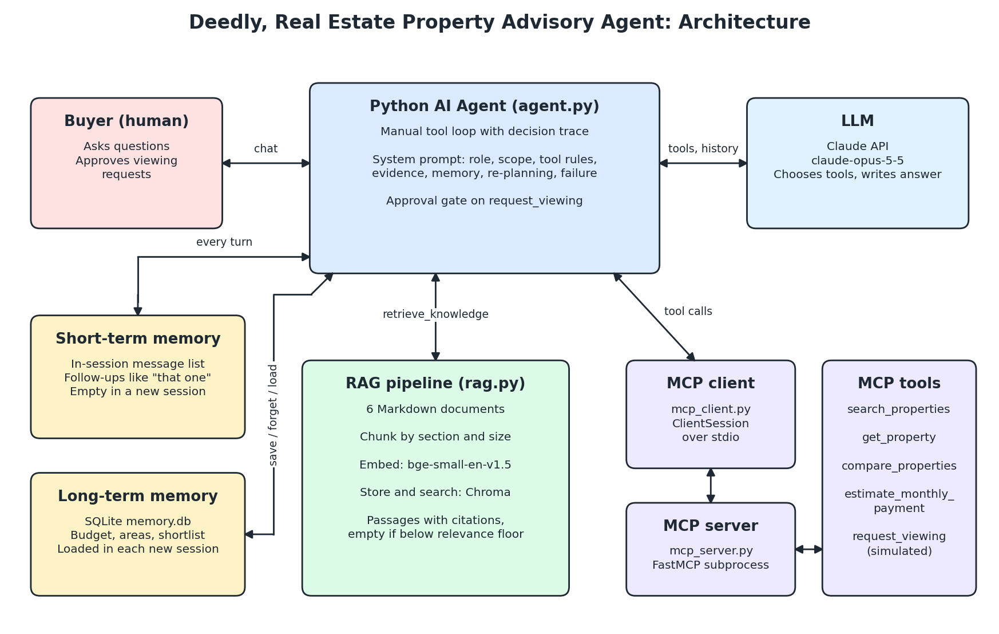

# Architecture

## Request flow

1. The buyer sends a message, which is added to the session's message list.
2. The agent sends the system prompt, saved buyer profile, tool list and conversation to the LLM.
3. The LLM answers directly or asks for one or more tools.
4. The agent runs each tool. Listing tools go through the MCP client to the server subprocess. Knowledge and memory tools run locally. Each call is recorded in a trace.
5. Tool results go back to the LLM, and steps 3 to 5 repeat until it writes a final answer, up to 10 steps.

## Components

**LLM.** Two providers are supported. Anthropic (Claude Opus 5.5) runs through the official Anthropic Python SDK. Groq (model discovered from the account's available models) runs through its OpenAI-compatible API, using the adapter in `realestate_agent/llm.py`, which translates messages, tool definitions and tool calls in both directions so the agent loop is identical for either provider. The loop is written by hand so that every tool decision can be traced and viewing requests can be stopped for approval.

**Short-term memory.** The message list held by one `PropertyAgent` instance. It resolves phrases like "the cheaper one" and is gone when the session ends.

**Long-term memory.** A table keyed by user and memory name, in SQLite locally or Postgres when `DATABASE_URL` is set (serverless hosts wipe local files between instances). The model saves lasting facts with `save_preference`, and saving under the same key replaces the old value. A new session loads the rows into the system prompt.

**RAG.** Ten Markdown documents (buying process, title, financing, inspection, neighbourhoods, advisory policy, taxes and transfer costs, housing societies and approvals, marla and kanal, documents glossary) are split by section and then by size (800 characters with 100 overlap), embedded locally with `BAAI/bge-small-en-v1.5`, and stored in Chroma using cosine distance. Results below a similarity of 0.6 are dropped. On-topic test questions measured 0.76 to 0.83 and unrelated ones 0.48 to 0.55. A question that is on theme but not covered can still pass this floor (a tax question scored 0.69), so the system prompt also tells the model to check that passages actually answer the question.

The default retriever is **hybrid**: the embedding retriever and a BM25 keyword retriever each rank the chunks, and the two rankings are merged by reciprocal rank fusion. Embeddings decide whether the documents cover the question at all, so a single shared word ("capital" in "capital of France" and "capital gains") cannot pull in a passage. BM25 adds exact-term matches such as *fard*, *LDA* or *kanal*. The index re-builds itself when any document changes.

**Grounding check.** After the model answers, every citation is compared with the passages retrieved in the session. A sentence that cites a passage that was never retrieved is removed and reported to the buyer, so every citation left in an answer can be opened (`/api/passage`) and read in full.

**RAG versus long-term memory.** RAG holds shared reference knowledge written in advance and is read-only to the agent. Long-term memory holds facts about one buyer, written by the agent during conversations. They use separate stores for that reason.

**MCP.** `mcp_server.py` is a FastMCP server started as a subprocess. `mcp_client.py` connects with the official MCP `ClientSession` over stdio, discovers tools with `list_tools` and invokes them with `call_tool`. Calls use the MCP protocol, not plain HTTP requests.

| MCP tool | Purpose |
|---|---|
| `search_properties` | Filter current listings |
| `get_property` | Live details and status of one home |
| `compare_properties` | Check homes against criteria and rank them |
| `estimate_monthly_payment` | Calculate a loan payment |
| `affordability_check` | Highest price under the 35 percent rule |
| `area_price_stats` | Median price per square foot and per marla by area |
| `request_viewing` | Simulated request, needs buyer approval |

Comparison and payment logic are deterministic code, so the model does not do arithmetic or ranking from memory.

**Re-planning.** Listing status lives in a database that can change during a session. The demo marks a chosen home as sold. The prompt tells the agent to re-check before recommending, drop a home that has gone, and compare the rest using the same criteria without relaxing the buyer's limits.

**Human oversight.** `request_viewing` passes through an approval check in the agent code, not only a prompt instruction. If the buyer declines, the MCP server is never called. The agent has no tool for making offers or payments.

**Error handling.** Tool failures return to the model flagged as errors, and the prompt tells it to report what could not be checked. API errors, refusals, truncated responses and runaway loops end the turn with a clear message and remove the unfinished turn from history, so the session can continue.

## System prompt justification

The prompt is in `realestate_agent/prompts.py`.

| Section | Why it is there |
|---|---|
| Role and scope | Keeps the agent on property topics. Sends legal and loan decisions to the right people, bans promises about returns, and bans steering by personal characteristics, which is a real fairness risk in housing advice. |
| Choosing a tool | Maps each kind of question to a tool, because listings change and must never come from memory, and arithmetic should come from code. It also says when not to call a tool, to avoid wasted calls. |
| Evidence | Requires citations so answers can be checked against sources, and separates data from judgement. Treating document text as data reduces prompt injection risk from listing descriptions. |
| Memory | Defines what is worth saving and what must never be saved. Saving under the same key prevents contradictory old values. |
| Re-planning | Sets what happens when facts change. Without it, a model could quietly raise the budget to find a match. |
| Uncertainty and failure | Tells the agent to admit gaps instead of inventing figures, which matters most for money decisions. Also states plainly what the agent cannot do. |

The prompt explains reasons where a rule could otherwise seem arbitrary, such as "because listings change", so the model can apply it sensibly to cases the prompt does not list.

## Evaluation

`evals/run_evals.py` measures retrieval on 36 labelled questions and agent behaviour on 22 scenarios with automatic checks. See `evidence/eval_report.md`.

## Known limitations

- Listings and documents are small and synthetic, so retrieval quality on a real corpus is untested.
- The relevance floor was tuned on queries from this corpus only, and the retrieval evaluation uses the same corpus.
- Saved memory is read once per session, so another session's edits appear only in the next session.
- There is no login. Locally the buyer name is trusted as given. On a public deployment each name is scoped to a signed per-browser cookie, so one visitor cannot read another's profile, but there are no accounts.
